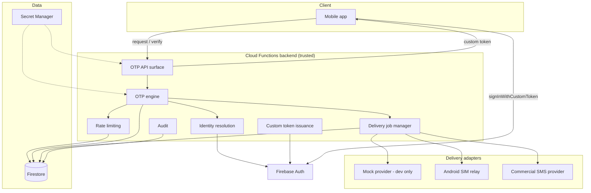

# Architecture

**Status of this document:** Living document. Describes the **planned** system; the only
implemented parts today are the Phase 1 skeleton (health function, contracts package, mock
provider), which are marked **Confirmed** below.

## 1. Context

The OTP Infrastructure Service is an independent backend that verifies phone ownership via
OTP and hands the client a Firebase session, preserving the client's existing Firebase
identity. Delivery is a replaceable adapter: development uses a mock provider; the first
real adapter is a dedicated Android device with a SIM; the long-term target is a compliant
commercial SMS provider.

## 2. Components

### Component responsibilities

| Component                                        | Responsibility                                                 | Trust                             |
| ------------------------------------------------ | -------------------------------------------------------------- | --------------------------------- |
| Client app                                       | Presents phone/code, calls backend, signs in with custom token | Untrusted                         |
| API surface (`functions/src/index.ts` growth)    | HTTP endpoints, request validation, error envelope             | Trusted                           |
| OTP engine (`functions/src/otp/`)                | Generation, normalization, challenge lifecycle, verification   | Trusted                           |
| Rate limiting (`functions/src/rate-limiting/`)   | Throttles and abuse controls                                   | Trusted                           |
| Audit (`functions/src/audit/`)                   | Privacy-preserving security events                             | Trusted                           |
| Identity (`functions/src/identity/`)             | Phone-hash → UID resolution                                    | Trusted                           |
| Token issuance                                   | Firebase custom tokens after verified challenge                | Trusted, highest sensitivity      |
| Delivery job manager (`functions/src/delivery/`) | Persist jobs, invoke providers, record receipts                | Trusted                           |
| Mock provider                                    | Dev/test only; production-guarded                              | Trusted for dev, never production |
| Android relay                                    | Claims jobs, sends SMS, reports results                        | Semi-trusted; compromise bounded  |
| Firestore                                        | State store for all backend collections                        | Trusted (rules deny clients)      |
| Firebase Auth                                    | Identity/session layer                                         | Trusted external                  |
| Secret Manager                                   | Peppers, provider/device secrets                               | Trusted                           |

## 3. Implemented today (Phase 1, Confirmed)

- `functions/src/index.ts` exports a single `health` HTTPS function (v2, region
  `asia-south1`) returning non-sensitive metadata.
- `functions/src/health.ts` is a pure payload builder plus an express-style handler, unit
  tested without network.
- `packages/contracts` defines the delivery-provider contract (types only).
- `functions/src/delivery/mock-provider.ts` implements the contract in memory, refuses to
  run with `NODE_ENV=production`, and is unit tested.
- No Firestore, no Admin SDK, no Auth, no token issuance, no relay exists yet.

## 4. Primary data flows (Proposed)

### 4.1 OTP request

1. Client calls `POST /v1/otp/requests` with a phone number.
2. Backend normalizes to E.164, checks rate limits, creates an `otp_challenges` document
   (hashed code, expiry, attempt counters) and a `delivery_jobs` document.
3. Delivery job manager invokes the configured provider.
4. Provider receipt is recorded on the job; challenges never depend on provider internals.
5. Response is enumeration-resistant: identical shape regardless of account existence.

### 4.2 OTP verification and sign-in

1. Client calls `POST /v1/otp/verifications` with challenge reference and code.
2. Backend atomically checks: challenge live, not locked, code hash matches, attempts under
   limit; on success marks `consumed` within the same transaction.
3. Identity layer resolves the phone hash to an existing Firebase UID or a deliberately
   created user (policy per D-013).
4. Backend mints a Firebase custom token and returns it.
5. Client signs in via `signInWithCustomToken`; the consuming app resolves profile/roles by
   UID exactly as today.

### 4.3 Relay delivery (Phase 4)

1. Relay device authenticates with an enrolled, revocable credential.
2. Device claims a pending job: one-time lease with expiry; duplicate claims are refused or
   return the same lease idempotently.
3. Device sends SMS via its SIM and reports submission outcome.
4. Backend records evidence level: relay accepted / Android submitted / carrier accepted /
   confirmed delivered (only if the provider can prove it — the relay cannot, so
   `confirmedDelivery` stays `false`).

## 5. Cross-cutting constraints (Proposed)

- Providers are swappable behind `DeliveryProvider`; OTP policy, verification, identity,
  and token issuance never import provider code directly (composition root selects the
  adapter; mock is the default and production-illegal).
- Single writer principle: only the backend mutates challenge/job/device/identity state.
- Every external input is validated and normalized at the boundary; error responses never
  leak account existence or internal detail.
- All security-relevant decisions are server-side and time is taken from the server clock.

## 6. Technology stack (Phase 1, Confirmed unless noted)

| Concern          | Choice                                                             | Rationale / decision                                                        |
| ---------------- | ------------------------------------------------------------------ | --------------------------------------------------------------------------- |
| Language         | TypeScript (strict, ES2022, NodeNext)                              | Type safety for security-critical logic                                     |
| Runtime target   | Node.js 22 (Cloud Functions supported runtime)                     | Official Firebase support matrix; local dev verified on Node 24 (D-007)     |
| Backend platform | Firebase Cloud Functions v2                                        | Managed auth integration, emulator suite, existing team familiarity (D-002) |
| Monorepo         | npm workspaces: `functions`, `packages/contracts`                  | Shared contracts without publishing (D-005)                                 |
| Storage          | Firestore (planned)                                                | Transactions + TTL; already in Firebase stack (D-011)                       |
| Identity         | Firebase Auth + Admin SDK (planned)                                | Preserves UIDs; custom tokens (D-013)                                       |
| Tests            | Vitest + Firebase Emulator Suite                                   | Fast TS-first tests; offline `demo-` projects                               |
| Lint/format      | ESLint flat config + Prettier                                      | Uniform style, CI enforcement                                               |
| CI               | GitHub Actions (file present; remote publishing approval required) | D-017                                                                       |

## 7. Non-goals reminder

This document does not authorize implementation of any unimplemented component. See
`docs/OTP_INFRASTRUCTURE_MASTER_ROADMAP.md` for phase statuses and approval gates.
