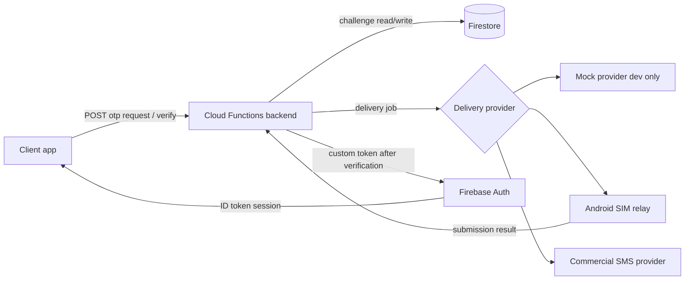
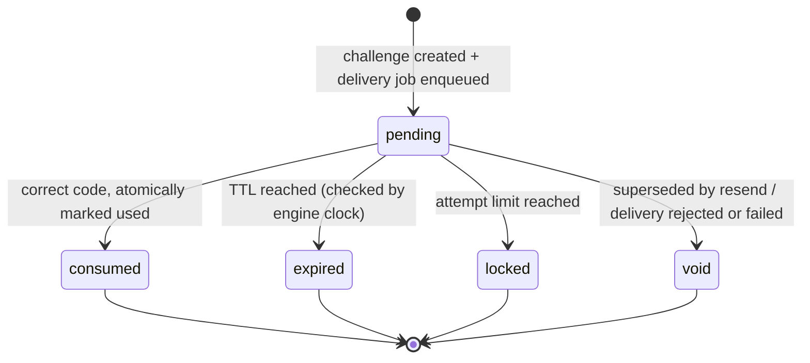

# OTP Infrastructure Service — Master Roadmap

**Document status:** Living specification. This is the primary source of truth for project
scope, architecture, and phase progress.
**Last updated:** 2026-10-17
**Current phase:** Phase 2 — READY FOR REVIEW (Phase 1 APPROVED; Phases 3–7 NOT STARTED)

> This document describes the **planned** architecture. Except where explicitly marked
> **Confirmed**, nothing in this document is implemented. The repository currently contains
> only the Phase 1 skeleton described in section 20.1.

---

## Status and labeling conventions

Every design statement in this document is labeled with exactly one of:

| Label                 | Meaning                                                                          |
| --------------------- | -------------------------------------------------------------------------------- |
| **Confirmed**         | Verified in the current repository or an official source at the time of writing. |
| **Proposed**          | Recommended design; not yet implemented or approved.                             |
| **Unverified**        | Requires investigation, testing, or external confirmation.                       |
| **Approval required** | Must not proceed without explicit owner authorization.                           |

Phase status values: `NOT STARTED` · `IN PROGRESS` · `BLOCKED` · `READY FOR REVIEW` ·
`APPROVED` · `COMPLETE`.

Rules:

- A phase is `COMPLETE` only after its acceptance criteria have actually passed, with real
  command output recorded in the phase report.
- Test results, provider capabilities, prices, and compliance conclusions are never
  asserted without evidence.
- Any implementation that reveals a flaw in this roadmap stops and proposes a documented
  revision (see `docs/DECISIONS.md`) instead of silently changing architecture.

---

## 1. Project vision and objectives

**Vision.** A secure, provider-independent OTP authentication backend that a client
application can rely on for phone-number verification and Firebase session issuance, where
the trusted backend — never the client or the Android relay — decides whether an OTP is
valid, and where the SMS delivery mechanism can be swapped (mock → Android relay →
commercial provider) without rewriting verification or identity logic.

**Objectives.**

1. Generate, store, deliver, and verify OTP challenges with server-side security controls
   (cryptographic randomness, keyed hashing at rest, expiry, single use, attempt limits,
   resend cooldowns, replay and concurrency protection, rate limiting). **Proposed**
2. Preserve Firebase identity: existing users keep their canonical Firebase UID, profiles,
   and roles; clients sign in with `signInWithCustomToken`. **Proposed**
3. Keep delivery replaceable behind a documented contract; ship a production-unsafe mock
   provider for development and an Android SIM relay as the first real adapter. **Proposed**
   (mock provider contract: **Confirmed** for Phase 1 skeleton)
4. Provide automated security, integration, reliability, and end-to-end tests. **Proposed**
5. Provide production-quality documentation, deployment procedures, and observability.
   **Proposed**
6. Integrate into CoolBus only after independent validation, behind a feature flag, without
   breaking existing UIDs, profiles, registration flows, roles, or sessions.
   **Approval required**

---

## 2. Scope and non-goals

**In scope.**

- OTP challenge lifecycle: request, generate, deliver, verify, consume. **Proposed**
- Firebase Admin SDK custom-token issuance after successful verification. **Proposed**
- Delivery provider abstraction plus mock, Android relay, and commercial-provider adapters.
  **Proposed**
- Device enrollment/revocation for the relay, with one-time job claims. **Proposed**
- Rate limiting, abuse detection hooks, audit events, observability. **Proposed**
- CoolBus integration **only after** independent validation and explicit approval.
  **Approval required**

**Non-goals (explicitly out of scope).**

- Replacing Firebase Authentication as the identity/session layer. **Proposed** (constraint)
- Building a general-purpose SMS gateway for third parties.
- Changing CoolBus UI, registration UX, role models, or profile schemas inside this
  repository. Any such change happens in the CoolBus repository under its own governance.
  **Approval required**
- Operating a commercial SMS account in Phase 1–5. Provider migration is Phase 7.
- Promising delivery guarantees, prices, or telecom compliance outcomes that have not been
  verified (see section 18).

---

## 3. System architecture and component responsibilities

**Proposed** high-level flow:



| Component                                             | Responsibility                                                                                                                           | Phase | Status                                                            |
| ----------------------------------------------------- | ---------------------------------------------------------------------------------------------------------------------------------------- | ----- | ----------------------------------------------------------------- |
| Cloud Functions backend (`functions/`)                | Trusted control plane: API surface, OTP policy, challenge storage, verification, rate limits, audit, identity resolution, token issuance | 2–3   | Skeleton **Confirmed**; logic **Proposed**                        |
| `@otp-infra/contracts` (`packages/contracts/`)        | Shared types: delivery-provider contract, error taxonomy interfaces; no runtime behavior                                                 | 1     | **Confirmed** (delivery contract only)                            |
| Mock delivery provider (`functions/src/delivery/`)    | Development/test delivery adapter; production-guarded                                                                                    | 1     | **Confirmed** (guarded, tested)                                   |
| Firestore                                             | Challenge store, delivery jobs, devices, identity links, rate-limit counters, audit events                                               | 2–4   | **Proposed**                                                      |
| Android SIM relay (`apps/android-sms-relay/` planned) | Dedicated device that claims jobs, sends SMS via dedicated SIM, reports results                                                          | 4     | **Proposed**; separate repository strongly considered (see D-008) |
| Commercial SMS provider adapter                       | MSG91-class provider implementing the same contract                                                                                      | 7     | **Proposed**; capability claims **Unverified**                    |
| Firebase Auth                                         | Identity and session layer; consumes custom tokens                                                                                       | 3     | **Proposed** (integration design)                                 |

Design rules:

- OTP policy, verification, identity resolution, and token issuance must not depend on any
  delivery provider implementation. **Proposed** (constraint on all later phases)
- The relay and any client are untrusted data sources; the backend re-validates everything.
  **Proposed**
- Firestore is the proposed store because the stack is already Firebase-based and supports
  transactions and TTL policies. **Proposed** (alternatives: Realtime Database, Redis —
  see D-011)

---

## 4. Trust boundaries and threat model

**Proposed** trust boundaries (detailed analysis in `docs/THREAT_MODEL.md`):

1. **Client ↔ backend:** everything from the client is untrusted; no client-supplied UID,
   role, or verification result is trusted. **Proposed**
2. **Backend ↔ delivery provider:** providers receive message content; the relay is
   semi-trusted and must not be able to verify OTPs or mint tokens. **Proposed**
3. **Backend ↔ Firebase Auth:** only the backend may mint custom tokens; Admin credentials
   live only in backend runtime secrets. **Proposed**
4. **Relay device ↔ backend:** device identity is enrolled and revocable; jobs are claimed
   once and expire. **Proposed**
5. **Admin/operator ↔ infrastructure:** all admin actions are audited; least privilege.
   **Proposed**

Headline threats (full table in `docs/THREAT_MODEL.md`): brute force, replay, concurrent
verification races, enumeration, SMS pumping/toll fraud, relay compromise, credential
theft, log/PII leakage, denial of service, duplicate identities, provider spoofing.

---

## 5. Firebase identity-preservation requirements

These are hard requirements for Phases 3, 5, and 6. **Proposed** as design; each requires
explicit test evidence before any phase can pass.

1. Backend receives OTP request → creates protected challenge → provider delivers →
   backend verifies → backend resolves the correct Firebase identity → issues a custom
   token → client signs in with `signInWithCustomToken` → profile/role resolution continues
   on the canonical Firebase UID.
2. Never trust a client-supplied UID for identity resolution.
3. Never create a new Firebase identity for a phone number that already belongs to an
   existing account.
4. Do not assume an Admin-SDK-created user behaves identically to a phone-verified user.
   Phone-number attachment, identity resolution, account creation, and session restoration
   are each tested explicitly. **Unverified** until Phase 3 tests run.
5. Custom tokens are issued only after successful verification of a live, single-use
   challenge.
6. Existing users retain their Firebase UID, profile documents, parenthood/student/fee
   relationships, operator/driver relationships, role resolution, onboarding flows, and
   session-restoration/logout behavior. **Approval required** before any CoolBus change.

---

## 6. Proposed repository and module structure

**Confirmed** current layout (Phase 1 + Phase 2):

```
otp-infrastructure-service/
├── functions/                     # @otp-infra/functions (Cloud Functions v2)
│   └── src/
│       ├── index.ts               # composition root: health, requestOtp, verifyOtp
│       ├── health.ts              # pure payload + express handler
│       ├── api/                   # callable handlers + requester-context hashing
│       ├── audit/                 # audit events + best-effort Firestore sink
│       ├── config/                # fail-fast environment configuration
│       ├── delivery/              # contract mock provider, dispatcher, factory
│       ├── otp/                   # policy, phone, random, hashing, state, engine, types
│       └── storage/               # transaction abstraction + Firestore adapter
├── packages/contracts/            # @otp-infra/contracts (types only)
│   └── src/{index,delivery}.ts
├── tests/
│   ├── unit/                      # engine, handlers, crypto, policy, static scans
│   ├── integration/               # Firestore emulator engine tests
│   ├── security/                  # Firestore rules denial tests
│   └── helpers/                   # in-memory DB (optimistic concurrency), clock, fakes
├── docs/                          # roadmap + living design docs + decision log
├── firestore.rules                # deny-all client rules (tested in the emulator)
├── .github/workflows/ci.yml
├── firebase.json                  # emulator config, demo- project usage
├── eslint.config.mjs, .prettierrc.json, vitest.config.mts, vitest.integration.mts
├── .env.example, .gitignore, README.md, CHANGELOG.md
```

**Planned** additions (created only when the owning phase starts):

```
functions/src/otp/            # generation, normalization, challenge lifecycle (Phase 2)
functions/src/rate-limiting/  # server-side throttles and abuse controls (Phase 2)
functions/src/audit/          # privacy-preserving audit events (Phase 2)
functions/src/identity/       # phone→UID resolution, custom tokens (Phase 3)
functions/src/delivery/       # guarded mock + relay adapter (Phase 1/4)
packages/test-utils/          # shared test fixtures/clock/emulator helpers (Phase 2)
apps/android-sms-relay/       # ONLY if the relay lives in this repository (see D-008)
tests/{integration,security,e2e}/  # created when the phase that needs them starts
```

**Proposed**: do not create empty directories in advance; a directory appears in the
commit that gives it working code.

---

## 7. OTP challenge lifecycle and state transitions

**Confirmed** (Phase 2, implemented and tested; see Appendix B):

- OTP: 6 numeric digits, CSPRNG-generated (`crypto.randomInt`; the JavaScript PRNG is
  banned by lint and a static test), never logged, never stored in plaintext. Stored as a
  keyed HMAC-SHA256 (`"code:v1:" + salt + ":" + purpose + ":" + code`, pepper from
  configuration) with a per-challenge salt; pepper version recorded per challenge so
  rotation invalidates live challenges detectably (max 5-minute impact).
- Challenge TTL: 5 minutes. Resend cooldown: 60 seconds. Max verification attempts: 5.
  Per-phone limit 3 requests/15 min; per-requester 10 requests/10 min and 20
  verifications/10 min; global 60 requests/min. All server-enforced in Firestore
  transactions; blocked requests consume no quota.
- Challenge states (implemented):



- Transitions are performed in Firestore transactions (`consumed`, attempt increments,
  voiding) so concurrent verification requests cannot both succeed. **Confirmed** by
  emulator tests: 10 concurrent correct submissions produce exactly one success.
- Attempts are only consumed by wrong codes; rate-limited verifications do not burn
  attempts but also never verify.
- Delivery outcome is tracked on the delivery job, not the challenge; a non-accepted
  delivery voids the challenge and clears the cooldown so the client can retry explicitly
  (no automatic SMS retry in Phase 2).
- Expiry is enforced by the backend clock at verification time (`Date.parse(expiresAt) <=
now`); Firestore TTL policies remain a future storage-retention mechanism only (D-023).

---

## 8. Delivery-provider contract

**Confirmed** (Phase 1): the contract lives in `packages/contracts/src/delivery.ts`:
`DeliveryProvider.send(DeliveryRequest) → Promise<DeliveryReceipt>` with:

- idempotency by `jobId`; providers must treat duplicate sends of the same jobId as the
  same logical send;
- `DeliveryStatus` = `accepted | rejected | failed`, where `accepted` means durable
  provider acceptance, **not** handset delivery;
- `capabilities.confirmedDelivery` to declare whether confirmed handset delivery can ever
  be reported; the mock provider reports `false` and must never be instantiated with
  `NODE_ENV=production` (enforced and tested);
- typed error codes (`INVALID_REQUEST`, `DESTINATION_REJECTED`, `PROVIDER_UNAVAILABLE`,
  `PROVIDER_RATE_LIMITED`, `PROVIDER_AUTH_FAILED`, `UNKNOWN`) with a `retryable` flag.

**Proposed** provider rules:

- The OTP engine persists a delivery job and records the receipt; it never inspects
  provider internals.
- Provider progression: **mock → Android relay → commercial provider**. Swapping providers
  must not require changes to OTP policy, verification, identity resolution, or token
  issuance.
- The relay adapter and any future provider adapter must pass the same contract test-kit
  (test-kit itself is Phase 4 work). **Proposed**

---

## 9. Android relay architecture

**Proposed** (Phase 4; not implemented):

- **Enrollment:** an operator enrolls a dedicated device; the backend issues a device
  credential stored hashed server-side; credentials are revocable.
- **Job delivery:** device authenticates, claims jobs (polling or long-poll), receives
  message jobs; claim is one-time with a lease/expiry, so process death or network loss
  cannot silently duplicate a send.
- **Send + report:** the relay submits via the dedicated SIM and reports
  submission result; the backend distinguishes relay acceptance, Android SMS submission,
  carrier acceptance, and confirmed delivery where evidence allows. A successful HTTP call
  is never treated as delivery.
- **Resilience:** offline periods, reconnects, reboots, duplicate claims, and expired jobs
  are all defined and tested (Phase 4 test list).
- **Security:** the relay cannot verify OTPs or mint tokens; compromise of the device must
  not compromise the OTP engine (only message content routed to it is exposed).
- **Repository decision:** the relay app may live in this repository under
  `apps/android-sms-relay/` or in a separate repository, depending on Gradle/Android build
  lifecycle friction. Recorded as D-008; **decide before Phase 4 starts**.

---

## 10. Firebase custom-token integration

**Proposed** (Phase 3; not implemented):

- Backend initializes Firebase Admin SDK with application-default credentials of a
  **dedicated test Firebase project** (Phase 3) — never CoolBus production. **Approval
  required** for any real-project usage.
- Identity resolution: normalized phone number → hashed lookup in an identity-link
  collection → existing UID, or a deliberately created new user. Never a client-supplied
  UID. **Unverified** details: whether/how to attach `phoneNumber` to existing users
  without SMS re-verification by Firebase; whether `signInWithCustomToken` preserves prior
  sessions; behavior for users without profiles. Each is an explicit Phase 3 test.
- Custom tokens are short-lived, single-purpose, and issued only after a verified,
  consumed challenge.
- Client signs in with `signInWithCustomToken`; profile/role resolution remains owned by
  the consuming application (CoolBus).

---

## 11. Data model and proposed collections

Summary — implemented in Phase 2 for the first five rows (full field-level detail in
`docs/DATA_MODEL.md`):

| Collection         | Purpose                              | Status                                                               |
| ------------------ | ------------------------------------ | -------------------------------------------------------------------- |
| `otp_challenges`   | One document per challenge           | **Implemented**: hashed code, attempts, expiry, state, job ref       |
| `otp_phone_state`  | Per-phone cooldown/limits/active ref | **Implemented**: resend cooldown + per-phone request window          |
| `requester_state`  | Per-requester request/verify windows | **Implemented**: fixed windows keyed by hashed client context        |
| `rate_limits`      | Global request bucket per minute     | **Implemented** (`req-global-<windowStartMs>` documents)             |
| `delivery_jobs`    | One document per delivery attempt    | **Implemented**; body/destination deliberately not persisted (D-019) |
| `audit_events`     | Privacy-preserving security events   | **Implemented**: no plaintext phones, codes, or tokens               |
| `delivery_devices` | Relay enrollment and health          | Phase 4 (not created)                                                |
| `identity_links`   | phone-hash → Firebase UID mapping    | Phase 3 (not created; strategy deliberately undecided — D-024)       |

**Confirmed** rules: clients have **no** read/write access to any collection (Firestore
rules deny everyone; emulator tests cover unauthenticated and authenticated contexts). No
plaintext OTPs or phone numbers anywhere at rest; enabled by design because job documents do
not persist message content. Retention mirrors (`ttlAtMs`/`ttlAt`) are written for every
document; TTL policy configuration is deferred (D-023).

---

## 12. API contracts and error semantics

Summary (**Proposed**; full contracts in `docs/API_CONTRACT.md`):

- `POST /v1/otp/requests` — create challenge + delivery job; enumeration-resistant response
  (same shape/status whether or not the phone belongs to an account).
- `POST /v1/otp/verifications` — verify code; on success return a Firebase custom token;
  generic error semantics that avoid revealing account existence.
- Relay endpoints (Phase 4): claim job, report result — device-authenticated, one-time
  claims, idempotent result reporting.
- Common error envelope with stable codes (`INVALID_REQUEST`, `RATE_LIMITED`,
  `CODE_INVALID`, `TOO_MANY_ATTEMPTS`, `CHALLENGE_EXPIRED`, `INTERNAL`) and no PII.
- `GET /health` — **Confirmed** implemented in Phase 1 (non-sensitive service metadata).

---

## 13. Security controls and abuse prevention

**Proposed**, to be implemented and tested in Phase 2+ (status per `docs/THREAT_MODEL.md`):

- CSPRNG OTP generation; no plaintext storage or logging; keyed hash with versioned pepper.
- Server-enforced expiry, attempt limits, resend cooldowns, single-use consumption.
- Atomic consumption to defeat concurrent-verification races and replay.
- Rate limiting per phone-hash, per IP (hashed), per device, and globally, with retry-after
  semantics; abuse detection for SMS pumping/toll-fraud patterns.
- Phone normalization to E.164 before hashing/lookup.
- Enumeration-resistant responses for request and verify.
- Firestore rules deny client access to all internal collections.
- Secrets in Cloud Secret Manager (or emulator-local equivalents), never in the repo.
- Audit events that never contain OTPs, full phone numbers, or tokens.
- Relay credentials hashed at rest, revocable, lease-bound job claims.
- No client-supplied UID/role trust anywhere.

---

## 14. Test strategy and acceptance criteria

**Proposed** strategy; Phase 1 harness **Confirmed** (Vitest, strict TS, CI):

- **Unit (`tests/unit/`)** — pure logic: normalization, code generation representation,
  policy evaluation, contract behavior. Mock/fake clock everywhere; no real network.
- **Integration (`tests/integration/`)** — Firebase Emulator Suite for Firestore/Auth
  functions against `demo-` projects; no production access ever.
- **Security (`tests/security/`)** — expiry, wrong code, replay, concurrency, resend
  limits, flood/rate-limit, enumeration responses, collection access denial.
- **E2E (`tests/e2e/`)** — complete flows including custom-token sign-in; relay
  reliability matrix in Phase 4/5.
- CI runs format, lint, typecheck, build, tests on every change (`.github/workflows/ci.yml`,
  **Confirmed** for the Phase 1 subset).
- Acceptance criteria per phase are defined in section 20; a phase may not be marked
  `COMPLETE` without executed evidence, including negative and abuse cases.

---

## 15. Deployment and environment separation

**Proposed** environments:

| Environment | Firebase project                                      | Purpose                                        | Rules                                                 |
| ----------- | ----------------------------------------------------- | ---------------------------------------------- | ----------------------------------------------------- |
| Local       | `demo-otp-infrastructure-service` (emulator, offline) | Development/tests                              | Never contacts Google services (demo- prefix)         |
| Test/Dev    | dedicated Firebase **test** project                   | Integration testing of real Admin SDK behavior | Created only when Phase 3 starts, with owner approval |
| Staging     | dedicated project                                     | Pre-production validation                      | Phase 7                                               |
| Production  | dedicated project                                     | Live service                                   | Phase 7; needs explicit approval, security review     |

- CoolBus production project is **never** used for this service's development or testing.
  **Approval required** for any exception.
- Secrets: Cloud Secret Manager with function-level binding via `defineSecret`; local
  emulator uses non-secret placeholders. `.env` files are git-ignored.
- Deployments are never performed without explicit approval; the Phase 1 repo contains no
  deployment automation beyond local emulator commands.

---

## 16. Observability and incident recovery

**Proposed** (Phase 2 growth, hardened in Phase 7):

- Structured JSON logs with correlation ids (challenge id, job id, request id) and
  **no** OTPs, tokens, or raw phone numbers.
- Audit events collection for security-relevant actions (challenge created, verified,
  locked, device enrolled/revoked, provider failures) with outcome and reason codes.
- Metrics candidates: request/verify rates, success/failure ratios, attempt-limit hits,
  rate-limit hits, provider latency/acceptance, relay last-seen age, delivery backlog.
- Alerts candidates: relay silent, provider auth failure, unexpected verify-error spikes,
  cost anomalies (SMS volume spikes).
- Incident runbooks: provider outage (disable provider, queue/fail closed), credential
  compromise (rotate pepper/device credentials, revoke), abuse spike (tighten throttles,
  disable registration path), rollback triggers (see section 19).

---

## 17. Cost categories and measurement strategy

**Proposed** measurement (no prices are asserted here; all provider pricing is
**Unverified** until sourced from official provider documentation):

| Category        | Driver                                          | Measurement approach                                           |
| --------------- | ----------------------------------------------- | -------------------------------------------------------------- |
| SMS messages    | OTP requests, retries, abuse                    | Count per day/week per provider; track rejection vs acceptance |
| Cloud Functions | Invocations, CPU/GB-s, min instances            | Billing export + logs-based metrics                            |
| Firestore       | Reads/writes per request lifecycle, TTL deletes | Usage dashboard; per-flow operation budget                     |
| Relay device    | Hardware + SIM plan + data + electricity        | Fixed cost tracking; per-message marginal = SMS plan cost      |
| Egress/logging  | Log volume, retention                           | Log router metrics; retention policy                           |

Abuse (SMS pumping) directly maps to money; rate limits in Phase 2 and monitoring in
Phases 5/7 are the primary cost controls.

---

## 18. Compliance questions requiring verification

All items **Unverified** — record evidence before real-user use; none may be assumed:

1. India DLT registration / TRAI requirements for transactional OTP SMS through a
   commercial provider (Phase 7); what template/entity registration is needed.
2. Whether the dedicated-SIM relay model (personal SIM sending OTP SMS at low volume) is
   permitted by the SIM's carrier terms and applicable regulations; "low volume" is not
   assumed to be an exemption.
3. Commercial provider onboarding requirements (MSG91-class), sender IDs, message
   templates, and quotas — from official provider documentation only.
4. Firebase Auth custom-token and phone-number handling requirements for the intended use.
5. Data protection: phone-number retention limits, consent, audit-log retention
   (DPDP Act considerations) for the operating jurisdiction.
6. Google Cloud / Firebase terms for the chosen project region and billing configuration.

Evidence required: official documentation links, provider statements, and — where relevant
— legal review. Until resolved, real-user SMS delivery remains **Approval required**.

---

## 19. Rollback and migration strategy

**Proposed**:

- Every phase is feature-flagged or independently deployable so it can be disabled without
  data loss.
- CoolBus integration (Phase 6) keeps the existing Firebase Phone Auth path available
  during migration; rollout behind a server-controlled feature flag with per-audience
  enablement; rollback = flag off + clients fall back to existing flow (existing sessions
  and UIDs untouched).
- Data: challenges/jobs/audit collections are operational data, never identity data; UIDs
  live in Firebase Auth. Rollback never deletes Auth users; identity links are additive
  mappings that can be re-pointed only by a reviewed migration.
- Provider rollback: disable relay adapter, re-enable mock/fail-closed mode; queued jobs
  are expired, not delivered late.
- Rollback of a deployment = redeploy previous function revision (Cloud Functions
  revisions) and re-point config; documented per environment when deployment starts
  (Phase 7).

---

## 20. Phased implementation checklist

### 20.1 Phase 1 — Independent Repository and Architecture Foundation

**Status: APPROVED** (owner approval received 2026-10-17; verification record in Appendix A)

- **Objective:** establish separate repository, structure, stack, conventions, docs, and a
  minimal runnable skeleton with tests and a mock delivery contract.
- **Scope:** repository scaffolding only. No OTP engine, no Firebase identity code, no
  relay, no CoolBus changes.
- **Dependencies:** none (only local Node/npm/Git).
- **Files/modules:** `functions/`, `packages/contracts/`, `tests/unit/`, `docs/`, root
  tooling configs, CI workflow. **Confirmed** (see README layout).
- **Security considerations:** no secrets; mock provider production guard; demo-project
  emulator configuration; no production Firebase access.
- **Implementation tasks:** [x] verify directory isolation; [x] `git init` on `main`;
  [x] stack decision + versions; [x] master roadmap + four design docs + decision log;
  [x] workspace skeleton; [x] health endpoint; [x] delivery contract + mock provider;
  [x] unit tests; [x] lint/format/typecheck/test tooling; [x] CI file.
- **Required tests:** health handler payload/response; mock provider accept/reject/fail,
  capabilities, production guard. **Confirmed** (executed in Phase 1 report).
- **Acceptance criteria:** all in section 20.1 of the owner brief — repository isolated,
  no secrets, roadmap contains all seven phases, skeleton builds and tests locally, lint
  and typecheck pass, mock contract defined and tested, honest reporting, no real OTPs, no
  production Firebase access, no custom tokens, no deployment.
- **Deliverables:** README, roadmap, architecture, threat model, data model, API contract,
  decisions, `.gitignore`, `.env.example`, package/config files, TS config, lint/format
  config, test config, minimal entry point, mock provider contract, small test set.
- **Risks:** toolchain drift (TypeScript 7 vs linter support — see D-003); workspace
  packaging vs Firebase deploy (D-009); scope creep into Phases 2+.
- **Approval gate:** owner review of this report before Phase 2 starts.

### 20.2 Phase 2 — Secure OTP Engine and Backend Foundation

**Status: READY FOR REVIEW** (implementation complete 2026-10-17; evidence in Appendix B)

- **Objective:** trusted OTP engine in isolated dev/test environment with mock provider.
  **Achieved** without touching identity, tokens, or real delivery.
- **Scope:** generation (CSPRNG), normalization, challenge creation/expiry/storage, attempt
  counters, resend policy, atomic consumption, replay/concurrency protection, rate
  limiting, enumeration-resistant responses, audit events, error handling, tests.
- **Dependencies:** Phase 1 approved (received); Firestore emulator (used); policy values
  reviewed and documented (D-012).
- **Files/modules (actual):** `functions/src/otp/` (policy, phone, random, hashing, state,
  types, engine), `functions/src/storage/` (transaction abstraction + Firestore adapter),
  `functions/src/rate-limiting/` logic embedded in `otp/state.ts` + engine transactions
  (no separate module was justified), `functions/src/audit/`, `functions/src/delivery/`
  (dispatcher + provider factory), `functions/src/api/` (callable handlers), `firestore.rules`,
  `tests/{unit,integration,security}/`, `tests/helpers/` (in-memory database with optimistic
  concurrency, fixed clock, recording logger/audit). The planned `packages/test-utils/`
  package was **not** created: all fakes live in `tests/helpers/` because only this
  repository consumes them (revisit in Phase 4 if the relay needs them).
- **Security considerations:** all of section 13 for the OTP engine; no plaintext OTPs or
  phone numbers at rest; pepper from environment with fail-fast validation (D-020); rules
  denying client access (tested); no client-supplied identity anywhere.
- **Required tests (all executed, see Appendix B):** successful verification, incorrect
  codes, expiry (including exact-boundary), attempt exhaustion and lock, resend cooldowns,
  per-phone/per-requester/global request limits, verify rate limits, delivery failures
  (rejected/failed/crash), replay, concurrent verification (in-memory and Firestore
  emulator), concurrent duplicate requests, challenge purpose binding, phone/code binding,
  secrets/OTPs kept out of logs and audit, mock provider production guard, prohibited-API
  static scan, Firestore rules denial.
- **Acceptance criteria:** Phase 2 acceptance gate from the owner brief — security and
  abuse-prevention tests pass; no production wiring; no real users. **Met** (tests executed
  with recorded results; identity/token work explicitly absent).
- **Deliverables:** engine + storage + audit + dispatcher + callable API + tests + rules;
  docs updated to implemented status (data model, API contract, threat model, decisions).
- **Risks:** Firestore transaction contention — mitigated with 20-attempt retry budget and
  validated by emulator concurrency tests; IP-based limits remain proxy-dependent (D-021);
  policy tuning awaits real traffic (Phase 5).
- **Approval gate:** security test evidence reviewed before Phase 3.

### 20.3 Phase 3 — Firebase Identity and Custom-Token Integration

**Status: NOT STARTED** — requires Phase 2 approval

- **Objective:** verified phone → correct Firebase identity → custom token, against a
  dedicated test Firebase project.
- **Scope:** identity resolution, creation policy, preservation of mappings, token
  issuance, client sign-in tests, session restoration, partial/no-profile cases, duplicate
  prevention, role/authorization boundary documentation.
- **Dependencies:** Phase 2 approved; dedicated test Firebase project (**owner approval
  required** to create); Admin SDK credentials confined to a test environment.
- **Files/modules:** `functions/src/identity/`, `tests/integration/`, `tests/e2e/`, docs.
- **Security considerations:** never trust client UID; tokens only after verified+consumed
  challenge; Admin credentials never in repo; test project isolation from CoolBus.
- **Required tests:** existing-UID preservation, new-user creation, conflict rejection,
  `signInWithCustomToken` client flow, session restore/logout, missing-profile behavior.
- **Acceptance criteria:** existing users retain UIDs; new-user creation works; conflicts
  rejected safely; session lifecycle tests pass; CoolBus production untouched.
- **Deliverables:** identity module, custom-token endpoint behavior, test evidence,
  documented identity rules.
- **Risks:** undocumented Firebase Auth edge cases (phone attachment, disabled users);
  emulator vs production behavior differences.
- **Approval gate:** test-project evidence reviewed; explicit approval before relay work.

### 20.4 Phase 4 — Dedicated Android SMS Relay

**Status: NOT STARTED** — requires Phase 3 approval

- **Objective:** authenticated relay device adapter delivering against the test backend.
- **Scope:** device enrollment/revocation, job claim (one-time, expiring), SMS submission,
  result reporting, reconnection/offline recovery, health, credential handling, ops docs.
- **Dependencies:** Phase 3 approved; relay repository decision (D-008); Android device +
  SIM; contract test-kit.
- **Files/modules:** relay app (location per D-008), `functions/src/delivery/relay-*`,
  `tests/integration/`, ops documentation.
- **Security considerations:** relay cannot verify OTPs or mint tokens; hashed revocable
  credentials; replay-safe claims; no OTP content retained on device beyond the send.
- **Required tests:** phone offline, internet interruption, process termination, reboot,
  duplicate jobs, expired jobs, failed submission, credential revocation; evidence levels
  for delivery distinguished.
- **Acceptance criteria:** relay works end-to-end against test backend; sender cannot
  independently verify OTPs or issue tokens.
- **Deliverables:** relay adapter + device app (or documented split), tests, runbook.
- **Risks:** Android SMS restrictions/OEM battery policies; carrier filtering; device
  reliability; SIM terms (compliance item 2).
- **Approval gate:** end-to-end relay evidence reviewed before Phase 5.

### 20.5 Phase 5 — End-to-End Pilot Validation

**Status: NOT STARTED** — requires Phase 4 approval

- **Objective:** validate the complete independent service before CoolBus integration.
- **Scope:** the full pilot test matrix in the owner brief (OTP flows, identities,
  abuse, relay outages, duplicates, sessions, monitoring, rotation, backup/recovery, cost
  measurement, rollback).
- **Dependencies:** Phase 4 approved; test environment; real SIM only after permitted use
  verified.
- **Files/modules:** `tests/e2e/`, operational runbooks, cost measurement notes.
- **Security considerations:** abuse drills; secret rotation drill; device revocation
  drill; privacy review of logs/audit.
- **Required tests:** all pilot matrix items with recorded evidence.
- **Acceptance criteria:** security and reliability tests pass; operational weaknesses
  documented; pilot can be stopped/rolled back safely.
- **Deliverables:** pilot report, updated threat model, runbooks, cost measurements.
- **Risks:** real-SIM variability; carrier behavior differences; findings invalidating
  earlier design (stop-and-revise rule).
- **Approval gate:** pilot report reviewed; explicit approval before any CoolBus work.

### 20.6 Phase 6 — Controlled CoolBus Integration

**Status: NOT STARTED** — requires Phase 5 approval + architecture amendment

- **Objective:** integrate the validated service into CoolBus behind a controlled rollout.
- **Scope:** inspect CoolBus auth implementation and docs first; architecture
  amendment/RFC approved; identify coupling points; feature-flag rollout; rollback plan.
- **Dependencies:** Phase 5 approved; CoolBus governance process; rollback rehearsal.
- **Files/modules:** CoolBus repository (separate governance); this repo only if the
  backend changes.
- **Security considerations:** preserve canonical UIDs; no duplicate accounts; existing
  Firebase Phone Auth path stays available during migration; no production credentials in
  this repo.
- **Required tests:** affected role-specific registration and authentication tests;
  duplicate-account checks; rollback demonstration.
- **Acceptance criteria:** all affected tests pass; no duplicate accounts; rollback
  demonstrated.
- **Deliverables:** approved RFC, integration changes (in CoolBus repo), test evidence,
  runbook.
- **Risks:** unknown coupling in CoolBus auth flows; user-facing regressions; governance
  delays.
- **Approval gate:** CoolBus architecture approval before implementation; explicit
  production rollout approval.

### 20.7 Phase 7 — Production Hardening and Delivery-Provider Migration

**Status: NOT STARTED** — requires Phase 6 approval

- **Objective:** sustainable production operation and migration to a compliant commercial
  provider (e.g., MSG91-class) implementing the same contract.
- **Scope:** production security review, throttling tuning, dashboards/alerts, audit
  logging, incident response, deployment/rollback automation, provider failure handling,
  cost/reliability measurement, credential rotation, compliance verification, provider
  migration parity tests.
- **Dependencies:** Phase 6 approved; compliance items resolved (section 18); provider
  account with verified capabilities/prices.
- **Files/modules:** provider adapter, deployment automation, dashboards, runbooks.
- **Security considerations:** production secret management, rotation, least privilege,
  alerting on abuse/cost anomalies.
- **Required tests:** provider parity tests across the contract; failover drills; rotation
  drills.
- **Acceptance criteria:** production meets documented security/ops requirements; provider
  migration passes parity tests; OTP engine, identity resolution, and Firebase session
  integration unchanged by the swap.
- **Deliverables:** hardened production deployment, provider adapter, runbooks, compliance
  evidence, cost report.
- **Risks:** provider pricing/quota unknowns; compliance blocking; production incidents
  during migration (mitigated by parity tests + rollback).
- **Approval gate:** production readiness review; explicit go-live approval.

---

## 21. Dependencies, risks, and approval gates

**External dependencies (all Unverified until confirmed from official sources):**

- Firebase Cloud Functions runtime support for Node.js 22 (official docs reviewed for
  Phase 1; re-verify at deploy time).
- Firebase Auth custom-token behavior for the exact identity scenarios in Phase 3.
- Android SMS send APIs and OEM restrictions (Phase 4).
- Commercial SMS provider capabilities, pricing, and compliance onboarding (Phase 7).
- CoolBus repository state, auth coupling, and governance process (Phase 6).

**Risk register (top risks):**

| #   | Risk                                 | Impact                               | Mitigation                                                                                     |
| --- | ------------------------------------ | ------------------------------------ | ---------------------------------------------------------------------------------------------- |
| R1  | SMS pumping/toll fraud               | Direct cost + abuse                  | Server-side rate limits, monitoring, provider caps (Phase 2/7)                                 |
| R2  | OTP bypass via race/replay           | Security                             | Atomic consumption + adversarial tests (Phase 2)                                               |
| R3  | Duplicate/incorrect identity mapping | User lockout, data corruption        | Identity resolution tests, no client UID trust, conflict rejection (Phase 3)                   |
| R4  | Relay device compromise              | Message interception for routed jobs | Scoped jobs, revocation, monitoring; device never holds verification/token authority (Phase 4) |
| R5  | Compliance blocker for SIM/OTP SMS   | Project stall                        | Section 18 verification before real-user use                                                   |
| R6  | CoolBus regression                   | User-facing outage                   | Feature flag, phone-auth fallback, rollback drill (Phase 6)                                    |
| R7  | Toolchain drift (TS 7/linter)        | Build friction                       | Pinned toolchain, D-003 documented, revisit after linter support                               |
| R8  | Emulator vs production behavior gaps | Late surprises                       | Separate test Firebase project in Phase 3, explicit parity tests                               |

**Approval gates (must not proceed without explicit owner approval):**

1. Phase 1 report → start Phase 2.
2. Phase 2 security evidence → start Phase 3.
3. Creation/use of any real (non-`demo-`) Firebase project → any point.
4. Phase 3 evidence → start Phase 4.
5. Relay repository decision (D-008) → before Phase 4 implementation.
6. Real-SIM usage after permitted-use verification → Phase 5.
7. Phase 5 pilot report → start Phase 6.
8. CoolBus architecture amendment → Phase 6 implementation.
9. Any production deployment, production credential use, or CoolBus production change.
10. Commercial provider onboarding and any legally binding provider commitment.

---

## 22. Decision log

The full record (context, alternatives, rationale, consequences, status, dates) lives in
`docs/DECISIONS.md`. Current entries:

- D-001 separate repository; D-002 TypeScript + Cloud Functions v2; D-003 TypeScript 5.9
  pin; D-004 CommonJS output; D-005 npm workspaces + contracts package; D-006 mock provider
  - production guard; D-007 Node 22 target / Node 24 local.
- D-008 relay repository split (open); D-009 deployment packaging for workspaces (open);
  D-010 region `asia-south1` (proposed).
- D-011 Firestore challenge store — **implemented in Phase 2** with a transaction
  abstraction and optimistic-concurrency tests; D-012 OTP policy values — **implemented in
  Phase 2**.
- D-013 identity/custom-token strategy (open, Phase 3); D-014 environment/project
  separation (constraint); D-015 secret management (proposed); D-016 CoolBus rollout
  mechanism (proposed, approval required); D-017 CI provider and remote publishing
  (approval required to publish).
- D-018 App Check adoption (open); D-019 no message/destination persistence in delivery
  jobs (Phase 2; revisit in Phase 4); D-020 pepper via environment now / Secret Manager
  later; D-021 callable functions and IP-control limitations; D-022 error mapping via
  HttpsError + stable `details.code`; D-023 TTL policy deferred to operations; D-024
  identity strategy deliberately undecided in Phase 2.

---

## Appendix A — Phase 1 verification record

Executed 2026-10-17 on the development machine (Windows; Node v24.19.0; npm 12.0.2; git
2.55.0; firebase-tools 15.34.0 via `npx`).

| Check               | Command                                                                                                             | Result                                                                                                                                                                |
| ------------------- | ------------------------------------------------------------------------------------------------------------------- | --------------------------------------------------------------------------------------------------------------------------------------------------------------------- |
| Format              | `npm run format:check`                                                                                              | Passed — all matched files use Prettier style                                                                                                                         |
| Lint                | `npm run lint`                                                                                                      | Passed — no ESLint findings                                                                                                                                           |
| Typecheck           | `npm run typecheck`                                                                                                 | Passed — contracts + functions under strict TS                                                                                                                        |
| Build               | `npm run build`                                                                                                     | Passed — contracts and functions compiled to `dist/`                                                                                                                  |
| Unit tests          | `npm test`                                                                                                          | Passed — 2 files, 9 tests                                                                                                                                             |
| Emulator smoke test | `npx firebase emulators:exec --only functions --project demo-otp-infrastructure-service "curl.exe -s <health url>"` | Passed — `{"status":"ok","service":"otp-infrastructure-service",...}` returned; demo project confirmed offline ("attempts to access non-emulated services will fail") |

Honest observations:

- npm 12 blocked install scripts for `protobufjs`, `re2`, and `@firebase/util` under its
  allowScripts policy. The Functions emulator works without them. The Firestore emulator
  (Java-based jar download) has **not** been exercised yet; it is not needed in Phase 1.
- The Functions emulator reports the Node 22 vs host Node 24 mismatch and uses host Node 24
  locally — expected per D-007; CI runs Node 22.
- The first emulator script attempt failed only due to inline-shell quoting of `node -e`;
  the emulator itself started and loaded the `health` function correctly.
- No Firebase production access, no custom tokens, no SMS sent, no deployment performed.
  Network use was limited to npm registry installs and emulator-local HTTP.
- No secrets are present in the repository; `.env.example` contains placeholders only.

---

## Appendix B — Phase 2 verification record

Executed 2026-10-17 on the development machine (Windows; Node v24.19.0; npm 12.0.2;
firebase-tools 15.34.0 via `npx`; Temurin JDK 25 for the Firestore emulator).

| Check                     | Command                                                                  | Result                                                                                                                                            |
| ------------------------- | ------------------------------------------------------------------------ | ------------------------------------------------------------------------------------------------------------------------------------------------- |
| Format                    | `npm run format:check`                                                   | Passed — all matched files use Prettier style                                                                                                     |
| Lint                      | `npm run lint`                                                           | Passed — no ESLint findings (includes CSPRNG/non-keyed-hash bans for `functions/src`)                                                             |
| Typecheck                 | `npm run typecheck`                                                      | Passed — strict TS across contracts + functions                                                                                                   |
| Build                     | `npm run build`                                                          | Passed                                                                                                                                            |
| Unit tests                | `npm test`                                                               | Passed — 10 files, **85 tests** (2 integration/security files skipped without emulator)                                                           |
| Integration + rules tests | `npm run test:integration`                                               | Passed — 2 files, **18 tests** against the Firestore emulator (demo offline project)                                                              |
| Static security scans     | included in unit suite                                                   | No `Math.random`, no non-keyed `createHash(` in production source; mock provider guard intact                                                     |
| Emulator callable smoke   | `firebase emulators:exec --only functions,firestore` + curl `requestOtp` | Passed — `{"result":{"challengeId":"...","expiresInSeconds":300,"resendAfterSeconds":60}}`; structured log `otp.request.created` contained no PII |

Test highlights (all executed, not inferred):

- Concurrent verification: 10 parallel correct submissions → exactly 1 success (in-memory
  optimistic concurrency AND real Firestore emulator).
- Concurrent duplicate requests: 5 parallel same-phone requests → exactly 1 challenge.
- Lifecycle: wrong code increments attempts; 5th failure locks; correct code rejected after
  lock; exact-expiry-boundary rejection; replay after consumptions rejected; resend voids the
  previous pending challenge; replay after void rejected.
- Abuse limits: per-phone (3/15 min), per-requester (10 requests, 20 verifies / 10 min),
  global (60/min; test override 2/min) — all enforced; blocked requests consume no quota.
- Delivery: provider rejected/failed/crashed → challenge voided, cooldown cleared, API maps
  to `SERVICE_UNAVAILABLE`; no automatic resend.
- Privacy: no test found any OTP code or phone digits in persisted documents, logs, or audit
  events; `otp_challenges.codeHash` is 64-hex HMAC; rules deny all client access.

Honest observations and limitations:

- One transient failure was observed once: with `--only functions,firestore` on a cold
  start, function discovery timed out after 10 s; the immediate rerun succeeded and the
  `--only functions` run always succeeded. Treated as an emulator cold-start quirk; the
  `test:integration` workflow (Firestore only + direct engine tests) is unaffected.
- First emulator callable invocation took ~3.9 s (Admin SDK init + metadata lookup timeouts
  in the offline emulator); subsequent handling is fast. Not representative of production.
- Firestore TTL policies on `ttlAt` are **not** configured yet (ops task, D-023); cleanup
  correctness does not depend on them.
- IP-based limits depend on `rawRequest.ip`, which is proxy-dependent (D-021); phone-number
  and global limits carry the primary abuse-prevention weight.
- Timing uniformity for enumeration resistance is best-effort and not measured (residual
  risk, threat model T17).
- No Firebase identities, custom tokens, real SMS, relay code, or production systems were
  involved. Network use was limited to npm registry installs and local emulators.
- GitHub Actions CI integration step for the emulator suite was added to the workflow file
  but **has not been executed on GitHub** (no remote repository; publishing requires owner
  approval D-017). Locally, the equivalent commands pass.
